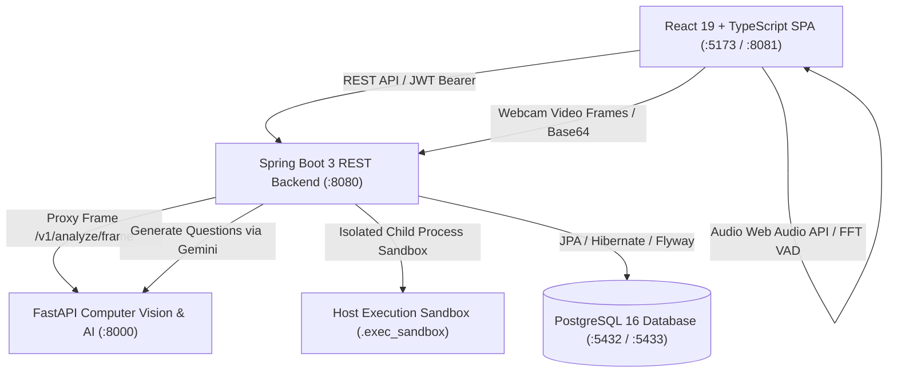
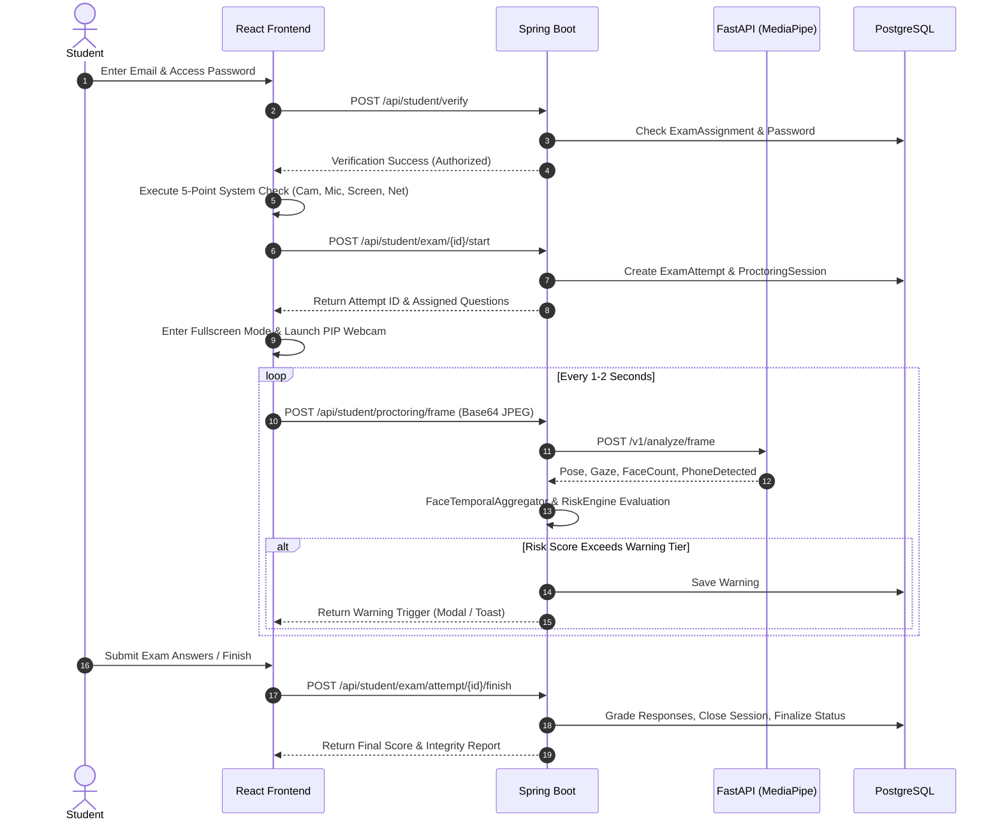
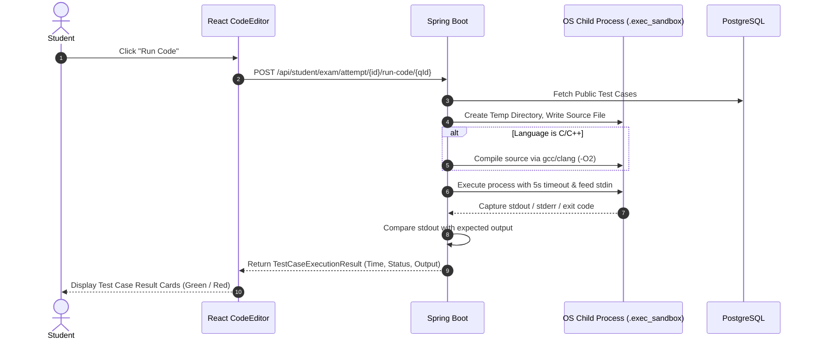

# AI Online Examination & Proctoring System (AEPS)
## Complete Codebase Specification, Function Index, and Architecture Guide

---

## 1. Overall System Architecture & Functionality

The **AI Online Examination & Proctoring System (AEPS)** is a distributed, full-stack educational assessment platform designed to deliver both **Multiple Choice Question (MCQ)** exams and **Live Coding Assessments** with strict anti-cheating enforcement.

### 1.1 High-Level Architecture Overview
The system is built on a **3-tier micro-architecture**:
1. **Frontend Client (`/frontend`)**:
   - Modern Single Page Application (SPA) providing candidate examination portals, live WebRTC media capture, browser lockdown listeners, real-time audio FFT speech analysis, an in-browser code editor, and an administrative command center with interactive Recharts data visualization.
2. **Core Backend Gateway (`/backend`)**:
   - Enterprise Spring Boot 3 / Java 21 REST API server. Handles JWT security, role-based access control (RBAC), Flyway relational schema migrations, student question random assignment, Sandboxed Code Execution for 4+ languages, Bucket4j per-IP rate limiting, NTP-anchored monotonic trusted time synchronization, exponential time-decayed behavioral risk scoring, and multi-format reporting (PDF, Excel, CSV).
3. **AI Vision & Assessment Service (`/ai-service`)**:
   - High-throughput asynchronous Python FastAPI service. Integrates MediaPipe Face Landmarker (478 3D facial landmarks), OpenCV SolvePnP head pose estimation (Pitch, Yaw, Roll), Iris gaze tracking, TFLite mobile phone / prohibited object detection, Random Forest question classification, and Google Gemini LLM question generation.
4. **Data Persistence (`/database` / PostgreSQL 16)**:
   - Relational database managing users, exams, questions, test cases, attempts, answers, proctoring sessions, telemetry events, warnings, refresh tokens, and audit logs.



---

## 2. Directory Structure of the Codebase

```
monitoring system/
├── CODEBASE_OVERVIEW.md               # Complete architecture, dependency & function reference (This Document)
├── README.md                          # Quickstart guide and Docker deployment instructions
├── function.md                        # High-level functional specification
├── docker-compose.yml                 # Multi-container orchestration (Postgres, Backend, AI, Frontend)
├── start-all.bat                      # 1-click batch script to launch Backend, AI, and Frontend
├── run-backend.bat                    # Launches Spring Boot via Maven Wrapper
├── run-frontend.bat                   # Launches Vite frontend server
├── run-ai.bat                         # Activates Python virtual environment & starts Uvicorn
├── check_db.bat                       # Verifies PostgreSQL connection
├── run-tunnel.bat                     # Exposes local server via Cloudflare Tunnel / Ngrok
├── simulate_students.py               # Stress test / simulation script for multi-candidate load testing
├── test_c.c / test_c.exe              # C toolchain probe test file
│
├── backend/                           # Spring Boot 3 Core Backend (Java 21)
│   ├── pom.xml                        # Maven dependency & build descriptor
│   └── src/
│       ├── main/
│       │   ├── resources/
│       │   │   ├── application.yml    # Database, JWT, CORS, port configurations
│       │   │   └── db/migration/      # Flyway SQL schema migrations (V1 to V11)
│       │   └── java/com/proctor/exam/
│       │       ├── ExamBackendApplication.java # Spring Boot entry point
│       │       ├── config/            # SecurityConfig, AdminSeeder
│       │       ├── controller/        # REST Controllers (Admin, Student, Public, Root)
│       │       ├── dto/               # 46 Request & Response Data Transfer Objects
│       │       ├── entity/            # 14 JPA Data Entities
│       │       ├── exception/         # Custom ApiException & GlobalExceptionHandler
│       │       ├── repository/        # 15 Spring Data JPA Repositories & Specifications
│       │       ├── security/          # JwtService, JwtAuthFilter
│       │       └── service/           # 14 Business logic & computation services
│
├── frontend/                          # Client Web Application (React 19 + TypeScript)
│   ├── package.json                   # NPM dependencies and build scripts
│   ├── vite.config.ts                 # Vite bundler, proxy & server config
│   ├── index.html                     # HTML5 mount template
│   └── src/
│       ├── main.tsx                   # React root mount
│       ├── App.tsx                    # React Router route registry & layout shells
│       ├── index.css                  # Global Tailwind CSS imports
│       ├── App.css                    # UI styles and animations
│       ├── api/                       # Axios / Fetch HTTP API connectors
│       ├── components/                # Reusable UI widgets (CodeEditor, MobileDeviceBlocker, NavBar)
│       ├── hooks/                     # Custom React hooks (useEventLogger)
│       ├── pages/                     # Routed view components
│       │   ├── Landing.tsx            # Public homepage
│       │   ├── Exams.tsx              # Public exam catalog
│       │   ├── Instructions.tsx       # Exam protocol & instructions
│       │   ├── About.tsx              # System architecture details
│       │   ├── student/               # Candidate workflow views (Verify, Check, Take, Code, Submit)
│       │   └── admin/                 # Administrator command center views (Dashboard, Create, Detail, Reports)
│       ├── types/                     # Shared TypeScript data models
│       └── utils/                     # Audio classifier, device detection, monotonic network clock
│
├── ai-service/                        # Computer Vision & AI Microservice (Python 3.10+)
│   ├── requirements.txt               # PIP package requirements
│   ├── Dockerfile                     # Docker container build script
│   └── app/
│       ├── main.py                    # FastAPI application initialization & routes
│       ├── config.py                  # Computer vision thresholds & model paths
│       ├── schemas.py                 # Vision API Pydantic schemas
│       ├── assessment_routes.py       # Coding assessment & Gemini question generation endpoints
│       ├── assessment_schemas.py      # Assessment Pydantic schemas
│       ├── models/                    # MediaPipe models & ONNX neural network
│       │   ├── face_detector.py       # Core MediaPipe 478-pt landmarker & SolvePnP head pose
│       │   ├── onnx_classifier.py     # 1D-CNN temporal sequence classifier
│       │   ├── efficientdet_lite0.tflite # Prohibited object detection model
│       │   ├── face_landmarker.task   # MediaPipe face mesh weights
│       │   └── face_detector.task     # MediaPipe face detection weights
│       └── services/                  # Auxiliary AI services
│           ├── question_generator.py  # Google Gemini LLM question generator
│           ├── code_executor.py       # Isolated Python script evaluation
│           ├── random_forest_service.py # scikit-learn use case classification
│           └── assessment_store.py    # In-memory question bank manager
│
└── database/
    └── README.md                      # PostgreSQL setup guidelines
```

---

## 3. Programming Languages Used & Their Specific Roles

| Language | Location | Specific Role in System |
|---|---|---|
| **Java (v21)** | `backend/src/` | Core server platform. Provides multithreaded transaction management, secure REST endpoints, database persistence via JPA/Hibernate, process sandboxing for code execution, statistical risk calculations, and enterprise report rendering (OpenPDF/POI). |
| **TypeScript (v6.0)** | `frontend/src/` | Type-safe frontend client logic. Powers responsive user interfaces, WebRTC video/screen streams, real-time Web Audio API DSP algorithms, browser-native event telemetry hooks, and administrative charts. |
| **Python (v3.10+)** | `ai-service/app/`, `simulate_students.py` | Computer vision and AI processing. Executes high-performance matrix math via OpenCV and NumPy, deep learning inference via MediaPipe and ONNX Runtime, scikit-learn Random Forest classification, and Gemini API prompt engineering. |
| **SQL (PostgreSQL Dialect)** | `backend/src/main/resources/db/migration/` | Database schema migrations via Flyway. Defines normalized tables, foreign keys, unique constraints, performance indexes, and cryptographic extensions (`pgcrypto`). |
| **Windows Batch (`.bat`)** | Root directory | Automation scripts for Windows environments (`start-all.bat`, `run-backend.bat`, `run-frontend.bat`, `run-ai.bat`, `check_db.bat`, `run-tunnel.bat`). Sets environment variables and launches background server instances. |
| **HTML5 & CSS3** | `frontend/`, `index.html` | Semantic markup and styling. Styled using modern Tailwind CSS v4, CSS Grid/Flexbox layouts, glassmorphism filters, and CSS keyframe animations. |
| **C / C++** | Root directory (`test_c.c`), Sandbox | Target languages compiled and executed on-the-fly during coding examinations by `CodeExecutionService`. |

---

## 4. Frameworks, Libraries, Versions & Dependencies

### 4.1 Backend (`backend/pom.xml`)
- **Runtime Environment**: Java 21 (LTS)
- **Framework**: **Spring Boot 3.3.4**
- **Core Dependencies**:
  - `spring-boot-starter-web`: Spring MVC REST controllers, Tomcat servlet container.
  - `spring-boot-starter-websocket`: Real-time WebSocket bidirectional communications.
  - `spring-boot-starter-security`: Spring Security filter chain, RBAC, password hashing.
  - `spring-boot-starter-data-jpa`: Hibernate ORM, Spring Data JPA repositories.
  - `spring-boot-starter-validation`: Jakarta Bean Validation (`@Valid`, `@NotNull`, `@NotBlank`).
  - `postgresql` (`42.7.x`): Production PostgreSQL JDBC driver.
  - `flyway-core` & `flyway-database-postgresql`: Automated database migration runner.
  - `jjwt-api`, `jjwt-impl`, `jjwt-jackson` (`0.12.6`): RFC 7519 JSON Web Token signing, parsing, and HMAC-SHA key derivation.
  - `bucket4j-core` (`8.10.1`): High-throughput in-memory token-bucket rate limiter.
  - `poi-ooxml` (`5.3.0`): Apache POI library for programmatic Excel (`.xlsx`) report generation.
  - `openpdf` (`2.0.3`): LibrePDF fork of iText for dynamic PDF certificate and audit report synthesis.
  - `lombok`: Boilerplate reduction (`@Getter`, `@Setter`, `@Builder`, `@Slf4j`).
  - `h2`: In-memory SQL database for unit testing.
  - `spring-security-test` & `spring-boot-starter-test`: Testing frameworks (JUnit 5, Mockito).

### 4.2 Frontend (`frontend/package.json`)
- **Runtime Environment**: Node.js 20+
- **Bundler & Build Tool**: **Vite 8.3.0** with `@vitejs/plugin-react 6.1.1`
- **Core Framework**: **React 19.2.8** & **React DOM 19.2.8**
- **Language**: **TypeScript ~6.0.2**
- **Dependencies**:
  - `react-router-dom` (`^7.18.4`): Declarative client-side routing.
  - `recharts` (`^3.10.1`): SVG charting engine for administrative dashboards.
  - `xlsx` (`^0.18.5`): Client-side spreadsheet generation and table parsing.
  - `react-is` (`^19.3.0`): React element type validation.
- **Styling & Tooling**:
  - `tailwindcss` (`^4.3.3`) & `@tailwindcss/vite` (`^4.3.3`): Utility-first CSS engine.
  - `postcss` (`^8.5.28`) & `autoprefixer` (`^10.6.1`): CSS post-processing.
  - `oxlint` (`^1.81.0`): High-performance Rust-based JavaScript/TypeScript linter.

### 4.3 AI Computer Vision Service (`ai-service/requirements.txt`)
- **Runtime Environment**: Python 3.10+
- **Web Framework**: **FastAPI >= 0.110.0**
- **ASGI Server**: **Uvicorn >= 0.28.0**
- **Data Validation**: **Pydantic >= 2.6.0**
- **Core AI & Math Libraries**:
  - `opencv-python-headless >= 4.9.0`: Image processing, Base64 decoding, SolvePnP pose estimation.
  - `mediapipe >= 0.10.11`: Google MediaPipe 478-point Face Landmarker and Object Detector.
  - `onnxruntime >= 1.17.0`: Cross-platform ONNX neural network execution engine.
  - `numpy >= 1.26.0`: Fast vectorized multi-dimensional numerical operations.
  - `scikit-learn`: Random Forest ML classification of coding problem domains.
  - `google-genai`: Google Gemini API client for automated exam question synthesis.

---

## 5. Granular Function-by-Function Reference

### 5.1 Backend Service Layer (`backend/.../service/`)

#### 1. `CodeExecutionService.java`
- **`runPublicTestCases(Long questionId, String code, String language, String customInput)`**:
  - Retrieves non-hidden test cases for a question or executes code against custom stdin input. Compiles and executes the solution in an isolated sandbox and returns execution time, stdout, stderr, and pass/fail status.
- **`evaluateAllTestCases(Long questionId, String code, String language)`**:
  - Evaluates candidate code against **both public and hidden** test cases for final exam scoring. Calculates score proportional to test cases passed.
- **`testRun(List<TestCaseRequest> testCases, String code, String language)`**:
  - Allows administrators or examiners to test code against ad-hoc test cases in real time before publishing a question.
- **`executeTestCases(List<ExamQuestionTestCase> cases, String code, String language)`**:
  - Internal runner iterating across test cases, checking execution limits, and aggregating results.
- **`executeSingleCase(int caseIndex, String code, String rawLanguage, String input, String expectedOutput)`**:
  - Spawns an isolated OS child process in a temporary sandbox directory (`.exec_sandbox`). Passes input through `stdin`, enforces a 5-second execution timeout, captures `stdout` and `stderr`, and checks output against expected results.
- **`buildCommand(String lang, String code, Path dir)`**:
  - Prepares the OS execution command based on language:
    - `python`: Writes `solution.py` and executes `python solution.py`.
    - `javascript`: Writes `solution.js` and executes `node solution.js`.
    - `java`: Writes `Solution.java` and executes `java Solution.java`.
    - `c` / `cpp`: Writes `solution.c`, invokes `gcc` or `clang` with `-O2` optimizations, produces an executable, and runs it.
- **`findCCompiler()`**:
  - Scans Windows `where.exe`, standard PATH, WinGet package folders, and MinGW installations to locate a working GCC or Clang compiler.

#### 2. `ExamAdminService.java`
- **`createExam(CreateExamRequest req, String adminEmail)`**: Validates exam parameters (start date, duration, passing marks, hardware requirements) and persists a new `Exam` entity in `DRAFT` status.
- **`updateExam(Long examId, UpdateExamRequest req, String adminEmail)`**: Modifies exam settings, enforcing permissions (Examiners can only edit their own exams).
- **`verifyExamAccess(Exam exam, String staffEmail)`**: RBAC security enforcement ensuring that staff with role `EXAMINER` cannot inspect or alter exams created by other administrators.
- **`listAll()`** / **`listExamsForUser(String staffEmail)`**: Returns full exam catalog or filtered list based on user privileges.
- **`getById(Long id)`** / **`getExamForUser(Long id, String staffEmail)`**: Fetches an individual exam, verifying ownership.
- **`publish(Long examId, String adminEmail)`**: Validates that all questions are present and switches status from `DRAFT` to `PUBLISHED`.
- **`addQuestion(Long examId, QuestionRequest req, String adminEmail)`**: Adds an MCQ or Coding question with test cases and validation.
- **`updateQuestion(Long questionId, QuestionRequest req, String adminEmail)`**: Updates question description, options, correct answers, or coding test cases.
- **`deleteQuestion(Long questionId, String adminEmail)`**: Removes a question and deletes its dependent test cases.
- **`listQuestions(Long examId, String adminEmail)`**: Lists all questions defined for an exam.
- **`assignStudents(Long examId, AssignStudentsRequest req, String adminEmail)`**: Assigns candidate email addresses to an exam and generates randomized access passwords.
- **`listAssignedStudents(Long examId, String adminEmail)`**: Retrieves roster of assigned students and their access passwords.
- **`unassignStudent(Long examId, String studentEmail, String adminEmail)`**: Revokes a student's eligibility for an exam.
- **`generateAiQuestions(Long examId, AiGenerateQuestionsRequest req, String adminEmail)`**: Proxies exam syllabus/topics to the AI service (Gemini API) and automatically populates the exam with MCQ and coding questions.
- **`assignSpecificQuestionsToStudent(...)`**: Randomly assigns a specific subset of questions from a larger pool to an individual student to prevent answer copying.
- **`getStudentQuestionAssignments(Long examId, String studentEmail)`**: Retrieves the question assignments for a specific student.

#### 3. `StudentExamService.java`
- **`verifyStudent(Long examId, String rawEmail, String rawPassword)`**:
  - Authenticates student eligibility for an exam. Checks whether the exam is published, active, open to all, or assigned with an access password.
- **`startExam(Long examId, String email, String ip, String userAgent)`**:
  - Initializes an `ExamAttempt`, anchors session start time to `TrustedTimeService`, checks max allowed attempts, initializes proctoring session, and returns attempt ID with assigned questions.
- **`getQuestionsForAttempt(Long attemptId, String email)`**:
  - Retrieves the sanitized questions (excluding correct answers and hidden test cases) assigned to the student's active attempt.
- **`submitAnswer(Long attemptId, Long questionId, SubmitAnswerRequest req, String email)`**:
  - Records student answer for an MCQ or executes and grades code for a coding question. Updates `ExamAnswer` in database.
- **`runPublicTestCases(Long attemptId, Long questionId, RunCodeRequest req, String email)`**:
  - Runs student code against public test cases during the live exam and returns execution feedback.
- **`finishExam(Long attemptId, String email)`**:
  - Concludes an exam attempt, grades all responses, sums MCQ and coding marks, records completion timestamp, closes the proctoring session, and determines pass/fail status.

#### 4. `RiskEngine.java`
- **`evaluateSession(ProctoringSession session, Instant now)`**:
  - Evaluates active proctoring telemetry for an attempt. Aggregates all violations, calculates the decayed risk score, and triggers progressive warnings (Tier 1, Tier 2, Tier 3) if thresholds are breached.
- **`calculateDecayedRiskScore(List<ProctoringEvent> events, Instant asOf, ...)`**:
  - Core mathematical risk scoring algorithm using exponential time decay:
    $$\text{Risk} = \sum (\text{Event Weight} \times e^{-\lambda \cdot \Delta t})$$
  - Recent events carry full weight, while older violations decay over time.
- **`computeRiskTimeline(Long attemptId)`**:
  - Generates time-series risk data points across the exam duration for the administrative Recharts graph.
- **`buildWarning(ProctoringSession session, int tier, BigDecimal score, String reason)`**:
  - Creates a formal `Warning` entity and records an audit log entry.

#### 5. `FaceTemporalAggregator.java`
- **`processFrameResult(Long attemptId, String studentEmail, AiFrameAnalysisResponse res, boolean isServiceAvailable)`**:
  - Receives raw computer vision frame analysis and applies debouncing/temporal filtering to prevent false alarms:
    - *Face Missing*: Requires face to be missing for > 3 consecutive seconds before triggering a `FACE_NOT_VISIBLE` event.
    - *Camera Covered*: Detects sudden black/low-variance frames and raises `CAMERA_COVERED`.
    - *Multiple Faces*: Requires multiple frames of multi-face presence before raising `MULTIPLE_FACES`.
    - *Gaze Tracking*: Debounces eye drift, requiring candidate to look away continuously (> 1.5s) before raising `LOOKING_AWAY`.
    - *Prohibited Objects*: Rate-limits `CELL_PHONE_DETECTED` and `PROHIBITED_OBJECT_DETECTED` events to avoid duplicate alerts.

#### 6. `TrustedTimeService.java`
- **`init()`** / **`scheduledSync()`**:
  - Synchronizes the backend with authoritative external Date & Time APIs (TimeAPI.io / Google HTTP Date headers) at startup and periodically every 15 minutes.
- **`now()`**:
  - Returns true UTC time derived from a hardware monotonic nanosecond timer (`System.nanoTime()`) anchored to verified network UTC, preventing tampering with the host OS clock.
- **`fetchNetworkTime()`**:
  - Queries external time APIs with failover and computes round-trip delay.
- **`getTimeSource()`**: Returns active clock mode (`NETWORK_API` or `LOCAL_FALLBACK`).

#### 7. `AiProxyService.java`
- **`analyzeFrame(String base64Image)`**:
  - Forwards candidate webcam frame to FastAPI at `POST /v1/analyze/frame` with timeout handling.
- **`generateQuestions(String topics, int numQuestions, String questionType, String difficulty)`**:
  - Calls FastAPI at `POST /v1/assessment/generate-exam-questions` to trigger Gemini LLM question generation.
- **`checkHealth()`**:
  - Queries FastAPI at `GET /health` to monitor service availability and degraded mode status.

#### 8. `ReportExportService.java`
- **`exportPdf(Long attemptId)`**:
  - Generates an institutional PDF examination report using OpenPDF. Includes student profile, score breakdown, proctoring summary, violation timeline table, and signature blocks.
- **`exportExcel(Long examId)`**:
  - Generates a multi-sheet `.xlsx` workbook using Apache POI containing attempt summaries and event logs.
- **`exportCsv(Long examId)`**:
  - Generates a comma-separated values (CSV) export for LMS integration.

#### 9. `AdminDashboardService.java`
- **`getSummary()`**: Returns high-level dashboard metrics (total exams, active exams, completed attempts, live examinees, warnings issued today, high-severity events).
- **`getStats()`**: Computes average exam scores, total attempts, and high-risk flagged sessions.
- **`getCharts(Long examId)`**: Aggregates distribution charts: violations by type, violations by exam, risk score distribution, and timeline trends.

#### 10. `AdminUserService.java`
- **`listUsers()`**: Returns all administrative users and examiners.
- **`getUserById(Long id)`**: Fetches a single user by ID.
- **`createUser(CreateAdminUserRequest request, String callerEmail)`**: Creates an administrator, examiner, or proctor with BCrypt-hashed password.
- **`updateUser(Long id, UpdateAdminUserRequest request, String callerEmail)`**: Updates user details or resets passwords.
- **`deleteUser(Long id, String callerEmail)`**: Removes a staff user account.

#### 11. `ProctoringSessionService.java`
- **`startSession(ExamAttempt attempt)`**: Initializes a proctoring session state machine.
- **`endSession(Long attemptId)`**: Closes the proctoring session upon exam completion.
- **`recordHeartbeat(Long attemptId)`**: Updates student heartbeat to monitor connectivity.

#### 12. `ProctoringEventService.java`
- **`recordEvent(Long attemptId, String eventType, String severity, String description, ...)`**: Persists a proctoring violation event to PostgreSQL and forwards it to the risk engine.
- **`recordBatchEvents(Long attemptId, List<ClientEventItem> events)`**: Efficiently inserts batches of browser-native telemetry events.

#### 13. `AdminAuthService.java`
- **`login(AdminLoginRequest req)`**: Validates admin credentials, checks lockout state, and issues access + refresh tokens.
- **`refresh(TokenRefreshRequest req)`**: Rotates single-use refresh token and issues a new JWT access token.
- **`logout(String refreshToken)`**: Revokes the active refresh token.

#### 14. `AuditLogService.java`
- **`logAdmin(String adminEmail, String action, String details)`**: Records an immutable audit log entry for administrative operations.

---

### 5.2 Backend REST Controller Layer (`backend/.../controller/`)

| Controller Class | Endpoint Path | HTTP Method | Method Name | Function & Purpose |
|---|---|---|---|---|
| **`AdminAuthController`** | `/api/admin/auth/login` | `POST` | `login` | Authenticates administrator; returns JWT and refresh token |
| | `/api/admin/auth/refresh` | `POST` | `refresh` | Rotates refresh token and issues new access token |
| | `/api/admin/auth/logout` | `POST` | `logout` | Revokes refresh token in database |
| **`AdminExamController`** | `/api/admin/exams` | `GET` | `listExams` | Lists all exams accessible to current staff |
| | `/api/admin/exams` | `POST` | `createExam` | Creates a new exam in DRAFT status |
| | `/api/admin/exams/{id}` | `GET` | `getExam` | Retrieves exam details |
| | `/api/admin/exams/{id}` | `PUT` | `updateExam` | Updates exam configuration |
| | `/api/admin/exams/{id}/publish` | `POST` | `publishExam` | Publishes exam, locking question set |
| | `/api/admin/exams/{id}/questions` | `GET` | `listQuestions` | Lists questions for an exam |
| | `/api/admin/exams/{id}/questions` | `POST` | `addQuestion` | Adds an MCQ or Coding question |
| | `/api/admin/exams/{id}/questions/{qId}` | `PUT` | `updateQuestion` | Updates question text, options, or test cases |
| | `/api/admin/exams/{id}/questions/{qId}` | `DELETE` | `deleteQuestion` | Deletes question |
| | `/api/admin/exams/{id}/assign` | `POST` | `assignStudents` | Assigns students and generates passwords |
| | `/api/admin/exams/{id}/assignments` | `GET` | `listAssignments`| Lists assigned students |
| | `/api/admin/exams/{id}/assignments/{email}` | `DELETE` | `unassignStudent` | Revokes a student's assignment |
| | `/api/admin/exams/{id}/ai-generate-questions` | `POST` | `generateAiQuestions` | Generates questions via Gemini AI |
| | `/api/admin/exams/test-run` | `POST` | `testRun` | Tests code execution in sandbox |
| **`AdminProctoringController`** | `/api/admin/dashboard/summary` | `GET` | `getSummary` | Returns KPI cards summary for dashboard |
| | `/api/admin/dashboard/stats` | `GET` | `getStats` | Returns overall exam statistics |
| | `/api/admin/dashboard/charts` | `GET` | `getCharts` | Returns Recharts data for analytics |
| | `/api/admin/reports/attempts` | `GET` | `listAttempts` | Filtered search of student attempts |
| | `/api/admin/reports/attempts/{id}` | `GET` | `getAttemptReport`| Detailed attempt forensic timeline |
| | `/api/admin/reports/export/pdf` | `GET` | `exportPdf` | Downloads official PDF report |
| | `/api/admin/reports/export/excel` | `GET` | `exportExcel` | Downloads Excel (.xlsx) report |
| | `/api/admin/reports/export/csv` | `GET` | `exportCsv` | Downloads raw CSV report |
| **`AdminUserController`** | `/api/admin/users` | `GET` | `listUsers` | Lists all staff accounts |
| | `/api/admin/users` | `POST` | `createUser` | Creates a new admin or examiner |
| | `/api/admin/users/{id}` | `PUT` | `updateUser` | Updates user details or resets password |
| | `/api/admin/users/{id}` | `DELETE` | `deleteUser` | Removes a staff account |
| **`StudentExamController`** | `/api/student/verify` | `POST` | `verifyStudent` | Verifies candidate eligibility & password |
| | `/api/student/exam/{id}/start` | `POST` | `startExam` | Initializes exam attempt & proctoring |
| | `/api/student/exam/attempt/{id}/questions` | `GET` | `getQuestions` | Fetches assigned questions |
| | `/api/student/exam/attempt/{id}/answer/{qId}` | `POST` | `submitAnswer` | Saves answer or evaluates code |
| | `/api/student/exam/attempt/{id}/run-code/{qId}` | `POST` | `runCode` | Runs code against public test cases |
| | `/api/student/exam/attempt/{id}/finish` | `POST` | `finishExam` | Submits exam and finalizes grades |
| **`StudentProctoringController`** | `/api/student/proctoring/frame` | `POST` | `processFrame` | Ingests webcam frame for AI analysis |
| | `/api/student/proctoring/event` | `POST` | `recordEvent` | Logs browser telemetry event |
| | `/api/student/proctoring/events/batch` | `POST` | `recordEventBatch`| Ingests batch of client events |
| | `/api/student/proctoring/heartbeat` | `POST` | `heartbeat` | Records candidate connectivity ping |
| **`PublicExamController`** | `/api/public/exams` | `GET` | `listPublicExams` | Lists published exams |
| | `/api/public/exams/{id}` | `GET` | `getPublicExam` | Retrieves exam syllabus & guidelines |
| | `/api/exams/time` | `GET` | `getTrustedTime` | Authoritative UTC monotonic time endpoint |
| **`RootController`** | `/` | `GET` | `root` | System status & welcome banner |

---

### 5.3 Frontend Architecture (`frontend/src/`)

#### 1. Pages (`frontend/src/pages/`)
- **`student/SystemCheck.tsx`**:
  - Executes a **5-point pre-flight hardware and network diagnostic**:
    1. Browser API compatibility (WebRTC, Fullscreen, MediaDevices).
    2. Webcam stream access and resolution check.
    3. Microphone audio capture and level verification.
    4. Display capture screen sharing authorization.
    5. Network round-trip latency measurement to backend.
  - Keeps the "Proceed to Exam" button disabled until all 5 checks pass. Provides resolution hints for denied permissions.
- **`student/ExamTake.tsx`**:
  - Live examination interface for MCQ tests.
  - Features:
    - Interactive question matrix (Answered, Unanswered, Marked for Review).
    - Monotonic exam countdown timer with auto-submission on expiry.
    - Draggable Picture-in-Picture (PIP) floating webcam preview with real-time status badge.
    - Automated background webcam frame capture sending frames at 1–2 fps.
    - Fullscreen lock and tab switch detection.
    - Real-time warning modal overlays on infractions.
- **`student/CodingAssessment.tsx`**:
  - Dedicated coding exam interface with split-pane layout:
    - Left Pane: Problem title, description, constraints, sample I/O, and test case status tabs.
    - Right Pane: Embedded syntax-highlighted code editor, language selector (C, Python, Java, JS), "Run Code" button, and "Submit Solution" button.
- **`student/ExamVerify.tsx`**:
  - Candidate identity verification form. Accepts Student Email and Exam Access Password, verifying against the backend before unlocking the pre-flight check.
- **`student/ExamSubmitted.tsx`**:
  - Post-exam summary displaying score, questions attempted, proctoring integrity status, and completion timestamp.
- **`admin/AdminDashboard.tsx`**:
  - Primary analytics dashboard featuring Recharts KPI cards, live examinee counter, violation distribution charts, and risk trend lines.
- **`admin/CreateExam.tsx`**:
  - Step-by-step exam creation wizard. Configures durations, marks, hardware constraints, and question pool settings.
- **`admin/ExamDetail.tsx`**:
  - Comprehensive exam management interface with tabs for:
    - Overview & status controls (Publish / Close).
    - Question builder (MCQ & Coding with test cases).
    - AI Question Generator (Google Gemini prompt interface).
    - Candidate roster assignment & access password generation.
    - Live attempt monitor.
- **`admin/AdminReportView.tsx`**:
  - Individual student attempt forensic inspector. Displays student profile, score, second-by-second event timeline, and one-click PDF, Excel, and CSV download buttons.
- **`admin/CodingAssessmentReports.tsx`**:
  - Reporting view specifically dedicated to coding attempts, showing test cases passed, runtime performance, and language breakdowns.
- **`admin/UserManagementTab.tsx`**:
  - Staff management panel allowing Admins to create, edit, and deactivate Examiner and Proctor accounts.

#### 2. Components (`frontend/src/components/`)
- **`CodeEditor.tsx`**:
  - In-browser code editor supporting line numbering, syntax highlighting, tab indentation handling, and theme styling.
- **`MobileDeviceBlocker.tsx`**:
  - Security component rendered at root. Detects mobile user agents, touch points, and small screen viewports. Displays a full-screen block requiring students to take exams on a desktop or laptop.
- **`NavBar.tsx`**:
  - Top navigation bar showing branding, route links, active user badge, and logout actions.

#### 3. Custom Utilities & Hooks (`frontend/src/utils/` & `hooks/`)
- **`audioSpeechClassifier.ts`**:
  - Client-side real-time audio digital signal processing (DSP) engine using Web Audio API:
    - *Biquad Highpass Filter (85 Hz)*: Removes electrical hum and desk vibration.
    - *Noise Floor Tracker*: Continuously measures background noise (fans, AC).
    - *Voice Activity Detector (VAD)*: Analyzes 180 Hz – 3400 Hz vocal formant frequencies.
    - *Non-Speech Rejection*: Rejects keyboard clicks, mouse clicks, and coughs via crest factor and transient sharpness analysis.
    - *Classifier*: Categorizes audio into `NORMAL_SPEECH`, `QUIET_SPEECH`, `WHISPER`, or rejected noise.
- **`deviceDetector.ts`**:
  - Comprehensive device inspector checking `navigator.userAgent`, `maxTouchPoints`, WebGL renderer strings, screen width, and pointer coarseness to prevent mobile device spoofing (even with "Desktop Mode" enabled).
- **`networkTime.ts`**:
  - NTP-style monotonic client clock. Fetches true UTC epoch time from `/api/exams/time` or external time APIs and increments via `performance.now()`. Immune to student OS clock changes.
- **`useEventLogger.ts`**:
  - Custom React hook managing browser telemetry event queuing, debouncing, and batch dispatch to `/api/student/proctoring/events/batch`.

---

### 5.4 AI Vision & Assessment Service Layer (`ai-service/app/`)

#### 1. Vision & Landmark Engine (`ai-service/app/models/face_detector.py`)
- **`analyze_frame(frame_b64: str) -> FrameAnalysisResponse`**:
  - Decodes Base64 JPEG frame into an OpenCV NumPy image array.
  - Evaluates image across MediaPipe Face Landmarker, SolvePnP head pose estimator, and TFLite Object Detector.
  - Returns face count, confidence, head pose Euler angles, iris gaze direction, and detected violation events.
- **`estimate_head_pose(landmarks_3d, img_w, img_h)`**:
  - Maps 6 landmark anchors (nose tip, chin, eye corners, mouth corners) to a 3D canonical face model.
  - Invokes `cv2.solvePnP` with camera intrinsic matrix to compute rotation vector (`rvec`) and translation vector (`tvec`).
  - Derives Euler angles: **Pitch** (up/down), **Yaw** (left/right), and **Roll** (tilt).
- **`estimate_iris_gaze(landmarks_2d)`**:
  - Calculates pupil iris center coordinates relative to inner and outer eye canthi.
  - Classifies gaze into `CENTER`, `LEFT`, `RIGHT`, `UP`, or `DOWN`.
- **`detect_prohibited_objects(image_rgb)`**:
  - Executes MediaPipe Object Detector (`efficientdet_lite0.tflite`). Scans for `cell phone`, `laptop`, and `book` classes with confidence thresholding.
- **`get_capabilities()`**:
  - Checks model bundle integrity and reports whether computer vision is running in full or degraded mode.

#### 2. Temporal ONNX Classifier (`ai-service/app/models/onnx_classifier.py`)
- **`classify_sequence(features: np.ndarray) -> str`**:
  - Passes temporal window of pose and gaze feature vectors into an ONNX Runtime 1D-CNN to classify complex behavioral sequences (e.g., suspicious repetitive side glancing).

#### 3. AI Assessment & Code Services (`ai-service/app/services/`)
- **`question_generator.py` -> `generate_exam_questions_llm(...)`**:
  - Constructs structured prompts for Google Gemini API to generate balanced MCQ and Coding questions with problem descriptions, function templates, constraints, and test cases.
- **`code_executor.py` -> `execute_code_submission(...)`**:
  - Executes Python code in a restricted subprocess with input/output validation against test cases.
- **`random_forest_service.py` -> `predict_use_case(...)`**:
  - Uses a trained scikit-learn Random Forest model to classify programming problems into industry use cases (e.g., Fintech, Healthcare, E-Commerce, Systems).
- **`assessment_store.py`**:
  - In-memory store and cache for generated assessment questions.

---

### 5.5 Database Migrations (`backend/src/main/resources/db/migration/`)

| Migration File | Tables / Schema Changes | Purpose |
|---|---|---|
| **`V1__init_schema.sql`** | `admins`, `students`, `exams`, `exam_questions`, `exam_assignments`, `exam_attempts`, `exam_answers`, `audit_logs` | Core relational schema for users, exams, MCQ questions, attempts, and answers |
| **`V2__proctoring_sessions.sql`** | `proctoring_sessions` | Tracks live candidate proctoring state, stream status, and heartbeat |
| **`V3__proctoring_events.sql`** | `proctoring_events` | Stores granular violation telemetry events with timestamps and severity |
| **`V4__warning_engine.sql`** | `warnings` | Stores progressive warnings issued to candidates during sessions |
| **`V5__audit_log_indexes.sql`** | Indexes on `audit_logs` | Optimizes query performance for security audit trail searches |
| **`V6__refresh_tokens.sql`** | `refresh_tokens` | Stores hashed, single-use refresh tokens for JWT rotation |
| **`V7__pgcrypto.sql`** | Extension `pgcrypto` | Enables cryptographic hashing functions in PostgreSQL |
| **`V8__coding_questions_and_test_cases.sql`** | `exam_question_test_cases`, modifies `exam_questions` | Adds support for coding problems, function templates, and test cases |
| **`V9__admin_user_credentials.sql`** | Modifies `admins` | Adds role management (`ADMIN`, `EXAMINER`, `PROCTOR`) and lockout fields |
| **`V10__exam_assignment_access_password.sql`** | Modifies `exam_assignments` | Adds unique per-student access passwords for secure exam entry |
| **`V11__student_question_assignments.sql`** | `student_question_assignments` | Tracks randomized question subset assignments per student |

---

## 6. End-to-End System Workflows & Data Flows

### 6.1 Student Examination Flow


### 6.2 Code Execution Flow


---

## 7. Operational Execution & Verification

### 7.1 Running Locally on Windows
Ensure PostgreSQL is active on port `5432` or `5433` as configured in `backend/src/main/resources/application.yml`.

1. **Launch All Services with 1-Click**:
   ```cmd
   start-all.bat
   ```
2. **Or Launch Individually**:
   - Backend: `run-backend.bat` (Starts on `http://localhost:8080`)
   - AI Service: `run-ai.bat` (Starts on `http://localhost:8000`)
   - Frontend: `run-frontend.bat` (Starts on `http://localhost:5173`)

### 7.2 Running via Docker Compose (Linux / Proxmox / Windows)
```bash
docker compose up -d --build
```
This orchestrates all four containers:
- `db`: PostgreSQL 16 (Port `5433:5432`)
- `backend`: Spring Boot 3 / Java 21 (Port `8080:8080`)
- `ai-service`: FastAPI / OpenCV / MediaPipe (Port `8000:8000`)
- `frontend`: React 19 / Nginx (Port `80:80`, `443:443`)

### 7.3 Default Credentials
- **Admin Email**: `admin@exam.com`
- **Admin Password**: `Admin@123`
- **Default Database**: `examdb` (User: `examuser`, Password: `exampass`)

---
*Document Version: 2.1.0*  
*Generated for: AI Online Examination & Proctoring System (AEPS)*
#sample test
varun